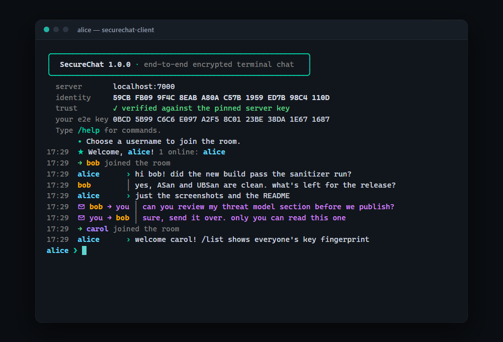
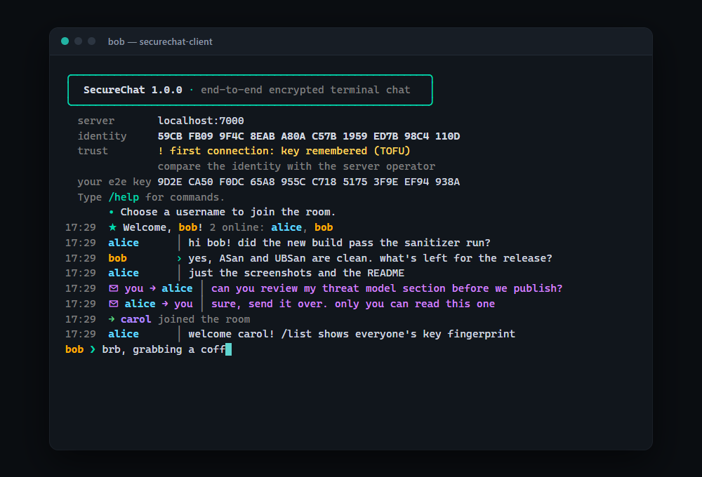
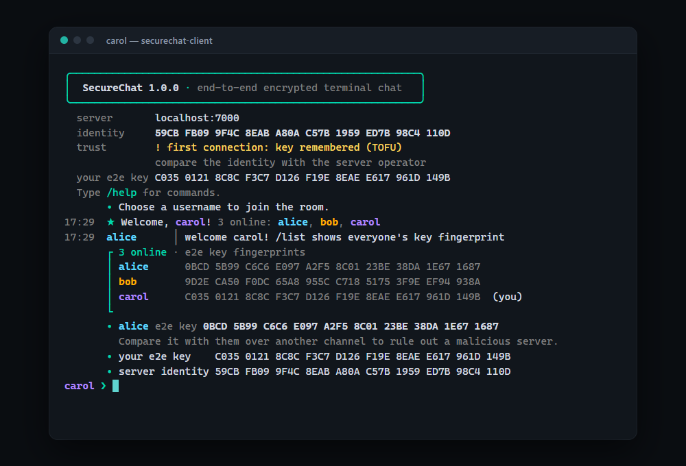
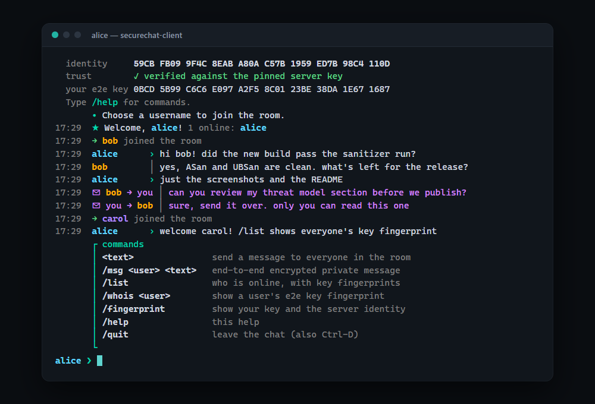
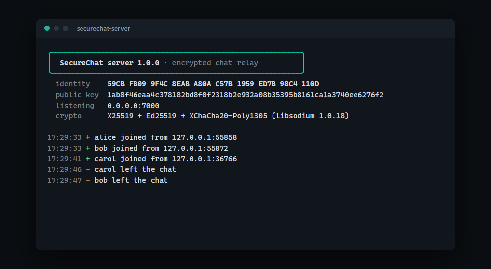
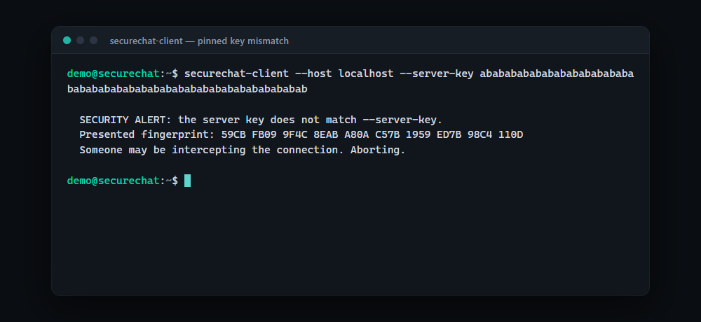

# SecureChat

Chat de terminal multiusuario escrito en C, con canal cifrado entre cada cliente y el servidor y mensajes privados cifrados de extremo a extremo. Toda la criptografía la aporta [libsodium](https://doc.libsodium.org/); el proyecto no implementa primitivas propias.



## Características

- **Sala pública** con difusión a todos los usuarios conectados y avisos de entrada y salida.
- **Mensajes privados de extremo a extremo** (`/msg`): el servidor solo reenvía texto cifrado que no puede leer. Tampoco puede devolverle a un usuario sus propios mensajes como si fueran del otro, ni repetirlos o reordenarlos. Lo que sí puede, mientras no se comparen las huellas, es sustituir las claves públicas que distribuye (ver el modelo de amenazas).
- **Autenticación del servidor**: el cliente verifica la identidad Ed25519 del servidor con una clave fijada (`--server-key`) o con *trust on first use* (fichero `known_hosts`), y aborta ante cualquier cambio.
- **Huellas verificables** (`/list`, `/whois`, `/fingerprint`) para comparar claves por otro canal.
- **Servidor de un solo hilo** basado en `poll(2)`, con sockets no bloqueantes, colas de salida acotadas con control de flujo, límite de 16 conexiones y expulsión de clientes que no completan la entrada en 30 s.
- **Nombres de usuario únicos** (sin distinguir mayúsculas), de 1 a 16 caracteres `[A-Za-z0-9_-]`.
- **Interfaz de terminal cuidada**: marcas de hora, un color por usuario, avisos con iconos y un prompt que conserva lo que se está escribiendo mientras llegan mensajes.
- **Robustez**: entradas validadas y acotadas en todas partes; el texto con caracteres de control se rechaza para impedir inyección de secuencias de escape en la terminal de otros usuarios.

## Capturas

Todas las capturas proceden de sesiones reales: los binarios se ejecutan en pseudo-terminales dentro de Docker y la pantalla resultante se renderiza a PNG (ver [Capturas de pantalla](#regenerar-las-capturas)).

| | |
|---|---|
|  |  |
| Mensajes privados y prompt que conserva el texto en edición | `/list`, `/whois` y `/fingerprint` |
|  |  |
| Ayuda de comandos | Registro del servidor (nunca registra contenido) |



## Seguridad

### Modelo de amenazas

| Adversario | ¿Protegido? | Mecanismo |
|---|---|---|
| Observador pasivo de la red | Sí | Todo lo posterior al *handshake* viaja cifrado (XChaCha20-Poly1305): contenido, nombres, lista de usuarios. |
| Atacante activo en la red (MITM, manipulación, repetición, reordenación) | Sí, si el cliente conoce la clave del servidor | Firma Ed25519 del *transcript* del *handshake*; `secretstream` detecta modificación, repetición y reordenación de mensajes. |
| Atacante activo en la **primera** conexión con TOFU | **No** | Igual que SSH: la primera clave se acepta. Use `--server-key` o compare la huella mostrada con el operador. |
| Servidor curioso u hostil frente a mensajes **privados** | Contenido: sí. Metadatos: no | `crypto_box` entre las claves de los dos usuarios; el servidor ve quién escribe a quién, cuándo y el tamaño. |
| Servidor hostil que sustituye las claves públicas de los usuarios | Solo si los usuarios comparan huellas | El servidor distribuye las claves `crypto_box`; `/whois` muestra la huella para verificarla por otro canal. |
| Servidor hostil que refleja, repite o reordena mensajes **privados** | Sí | El texto cifrado incluye la clave del emisor, la del destinatario y un contador por emisor; el receptor rechaza lo que no venga del remitente anunciado hacia él o no sea más reciente que lo ya recibido. |
| Servidor frente a mensajes **públicos** | **No** | La sala pública se cifra solo hasta el servidor, que retransmite el texto. |
| Usuario malicioso | Parcialmente | Validación de nombres y texto (UTF-8 imprimible, sin controles), tamaños máximos, cuotas de memoria por conexión y control de flujo: una ráfaga no desconecta a quien lee con normalidad. No hay limitación de frecuencia de mensajes. Ver también las limitaciones conocidas. |
| Robo de la clave privada del servidor | Secreto hacia adelante: sí | Las claves de sesión salen de claves X25519 efímeras; la clave de identidad solo firma. Con ella sí se puede suplantar al servidor en el futuro. |

Fuera de alcance: autenticación de usuarios (cualquiera puede elegir un nombre libre), identidad persistente de usuarios entre sesiones, anonimato y protección contra análisis de tráfico, denegación de servicio volumétrica y compromiso de los equipos finales.

### Diseño criptográfico

Todas las primitivas son de libsodium 1.0.18:

1. **Identidad del servidor**: par Ed25519 (`crypto_sign`) persistente en un fichero con permisos `0600`.
2. **Handshake** (inspirado en el de TLS 1.3 con autenticación solo del servidor):
   - `ClientHello = "SCH1" ‖ versión ‖ clave X25519 efímera del cliente`.
   - `ServerHello = "SCH1" ‖ versión ‖ clave X25519 efímera del servidor ‖ clave pública Ed25519 ‖ firma ‖ cabecera secretstream`.
     La firma cubre `contexto ‖ efímera_cliente ‖ efímera_servidor ‖ identidad ‖ cabecera`, por lo que no se puede reutilizar con otro cliente ni alterar ningún campo.
   - El cliente verifica la firma y **después** comprueba la identidad contra `--server-key` o `known_hosts`; solo entonces envía `ClientFinish` (su cabecera secretstream).
   - Las claves de sesión se derivan con `crypto_kx` (X25519 + BLAKE2b sobre ambas claves públicas): una clave por dirección.
3. **Transporte**: `crypto_secretstream_xchacha20poly1305`, un flujo por dirección. libsodium gestiona los nonces internamente (no hay reutilización posible), autentica cada mensaje y encadena el estado, por lo que repetir, reordenar o descartar un mensaje rompe el canal.
4. **Mensajes privados**: cada cliente genera un par `crypto_box` (X25519 + XSalsa20-Poly1305) por sesión y lo anuncia al entrar. El emisor cifra `clave_emisor ‖ clave_destinatario ‖ contador ‖ texto` con la clave del destinatario y un nonce aleatorio de 24 bytes (colisión despreciable). Como la clave de `crypto_box` es la misma en ambos sentidos, el MAC por sí solo no indica quién cifró: el receptor comprueba además que el emisor incluido es la clave anunciada para ese usuario y que el destinatario es él mismo (así rechaza un mensaje propio reflejado), y que el contador supera al último aceptado de esa clave (así rechaza repeticiones y reordenaciones). Como las claves son por sesión, basta un contador por sesión. Esto autentica al remitente frente a la clave que el servidor anunció, no frente a una persona: para eso hay que comparar huellas.
5. **Huellas**: BLAKE2b-160 de la clave pública, mostrada en 10 grupos hexadecimales.
6. **Higiene de secretos**: claves efímeras y de sesión se borran con `sodium_memzero` en cuanto dejan de usarse; las comparaciones de claves usan `sodium_memcmp`.

### Formato en la red

Cada trama es `longitud (u32 big-endian) ‖ carga`. Las tres primeras tramas son el *handshake*; el resto son textos cifrados de un mensaje de aplicación (`tipo ‖ campos`, con cadenas prefijadas por `u16`). El límite de 2048 bytes (`SC_PAYLOAD_MAX`) se aplica al mensaje de aplicación en claro; una vez cifrado con `secretstream` (17 bytes: etiqueta de 1 byte y MAC de 16), la carga de una trama en la red ocupa como máximo 2065 bytes (`SC_FRAME_MAX`), más los 4 bytes del prefijo de longitud. Una longitud nula o mayor que 2065 cierra la conexión antes de reservar memoria. Cada campo se valida al decodificar (longitudes, nombres, UTF-8 seguro, ausencia de bytes sobrantes) tanto en el servidor como en el cliente.

## Requisitos

- **Docker** (recomendado; es la única dependencia en Windows y macOS).
- Para compilar en Linux: compilador C11 (GCC o Clang), `make`, `pkg-config`, `libsodium-dev` y `python3` para la prueba de integración.

## Ejecución con Docker

```bash
docker compose up -d --build server      # servidor en 127.0.0.1:8120 del host
docker compose run --rm client           # un cliente interactivo; repítalo en otra terminal
docker compose logs server               # huella y clave pública del servidor
docker compose down                      # detener (añada -v para borrar la clave)
```

Para fijar la clave del servidor en lugar de usar TOFU:

```bash
KEY=$(docker compose exec server securechat-server --show-key | awk '/public key/ {print $3}')
docker compose run --rm client --host server --port 7000 --server-key "$KEY"
```

Por defecto el puerto se publica solo en la interfaz de bucle local (`127.0.0.1:8120`), de modo que desde el host únicamente se puede conectar el propio equipo (los contenedores de la red `securechat-net`, como el cliente de `docker compose run`, usan `server:7000` directamente). Para aceptar conexiones de otras máquinas, cambie en `docker-compose.yml` la línea `"127.0.0.1:8120:7000"` por `"8120:7000"` (todas las interfaces) o por `"<IP>:8120:7000"` (una interfaz concreta) y abra el puerto en el cortafuegos; recuerde que entonces cualquiera que alcance ese puerto puede entrar en la sala.

La imagen ejecuta los binarios con un usuario sin privilegios; la clave del servidor vive en el volumen `securechat-data` y el `known_hosts` de los clientes en `securechat-client-home`.

## Compilación y uso en Linux

```bash
make                                       # build/securechat-server y build/securechat-client
./build/securechat-server --port 7000      # crea securechat_server.key si no existe
./build/securechat-client --name alice     # en otra terminal (host 127.0.0.1, puerto 7000)
```

Opciones principales (ver `--help`):

| Programa | Opción | Descripción |
|---|---|---|
| servidor | `--port`, `--bind` | Dirección de escucha (por defecto `0.0.0.0:7000`). |
| servidor | `--key PATH` | Fichero de identidad (o variable `SECURECHAT_KEY`). |
| servidor | `--show-key` | Imprime clave pública y huella, y termina. |
| cliente | `HOST [PORT]`, `--host`, `--port` | Servidor al que conectarse. |
| cliente | `--name NAME` | Nombre de usuario (si no, se pregunta). |
| cliente | `--server-key HEX` | Fija la clave pública del servidor (64 hex). |
| cliente | `--known-hosts PATH` | Almacén TOFU (por defecto `$SECURECHAT_HOME/known_hosts` o `~/.securechat/known_hosts`). |
| ambos | `--color auto\|always\|never` | Colores ANSI (respeta `NO_COLOR`). |

### Comandos del chat

| Comando | Acción |
|---|---|
| `<texto>` | Mensaje a toda la sala. |
| `/msg <usuario> <texto>` | Mensaje privado cifrado de extremo a extremo (alias `/private`, `/w`). |
| `/list` | Usuarios conectados con la huella de su clave (alias `/who`). |
| `/whois <usuario>` | Huella de la clave de un usuario. |
| `/fingerprint` | Su huella y la del servidor. |
| `/help` | Ayuda. |
| `/quit` | Salir (también `/exit`, Ctrl-D o Ctrl-C). |

## Pruebas

```bash
docker build --target test .     # todo lo siguiente dentro de Docker (sanitizadores con GCC 14)
make test                        # pruebas unitarias
make integration                 # servidor + clientes reales + captura del tráfico
make check                       # unitarias + integración
make sanitize                    # todo de nuevo con AddressSanitizer + UBSan
```

Cada binario de prueba y la prueba de integración se ejecutan bajo `timeout` (300 s por defecto, configurable con `TEST_TIMEOUT=N`), de modo que un bloqueo hace fallar la ejecución en lugar de dejarla colgada. `make sanitize` necesita GCC 14 o posterior en núcleos con `vm.mmap_rnd_bits=32`: el AddressSanitizer de GCC 12 se queda colgado de forma aleatoria imprimiendo `AddressSanitizer:DEADLYSIGNAL` sin fin. Por eso la etapa de sanitizadores del `Dockerfile` usa la imagen `gcc:14` con el mismo libsodium 1.0.18.

- **Unitarias** (7 suites, 278 comprobaciones): tramas (límites, lecturas parciales, longitudes inválidas), criptografía (*handshake* completo, manipulación, repetición, reordenación, `ClientHello`/`ServerHello` falsificados, clave de bajo orden, mensajes E2E, reflexión y repetición de mensajes E2E, nonces frescos, huellas), control de flujo del servidor real (una ráfaga de 150 mensajes privados no desconecta a un destinatario que lee; uno que deja de leer sí se desconecta), codificación de mensajes (ida y vuelta, entradas truncadas, sobrantes, secuencias de escape, 20 000 entradas aleatorias), validación de texto UTF-8, almacén de claves y `known_hosts`, analizador de comandos y editor de línea.
- **Integración** (45 comprobaciones): arranca el servidor y un proxy TCP que graba todos los bytes; verifica la clave fijada y TOFU (incluida la alerta por cambio de clave), chat entre usuarios, mensajes escritos durante la entrada, mensajes privados, avisos de entrada y salida, nombres duplicados, conexiones hostiles (longitud gigante, *handshake* inválido, tráfico HTTP), apagado ordenado con `SIGTERM`, y que la captura de red **no** contiene ningún texto, nombre de usuario ni mensaje privado en claro.

El código compila sin avisos con `-std=c11 -Wall -Wextra -Werror -Wpedantic -Wshadow -Wformat=2 -O2 -D_FORTIFY_SOURCE=2 -fstack-protector-strong`.

## Arquitectura

```
include/securechat/   API compartida
  protocol.h          constantes del protocolo y límites
  frame.h             tramas con prefijo de longitud (sin E/S)
  crypto.h            handshake, canal secretstream, crypto_box, huellas (sin E/S)
  message.h           codificación/validación de mensajes de aplicación
  text.h              validación de nombres y texto UTF-8 seguro
  keystore.h          fichero de identidad y known_hosts (TOFU)
  net.h, term.h       sockets y estilos de terminal
src/common/           implementación de lo anterior
src/server/           bucle poll(2), estado de la sala y CLI del servidor
src/client/           sesión, comandos, editor de línea, interfaz y CLI del cliente
tests/                pruebas unitarias en C y prueba de integración en Python
scripts/screenshots/  herramienta que genera las capturas a partir de sesiones reales
```

Los módulos criptográficos y de protocolo no realizan E/S, lo que permite probarlos en memoria. El servidor es de un solo hilo: cada conexión tiene una máquina de estados (`HELLO → FINISH → JOIN → ACTIVE`), un búfer de entrada del tamaño de una trama máxima y una cola de salida de 64 KiB. Cada conexión procesa como máximo 8 tramas por ronda de `poll` y las colas se vacían al final de cada ronda; mientras alguna cola supera la mitad (32 KiB), el servidor deja de leer de los clientes unidos hasta que se vacíe. Un cliente cuya cola sigue por encima de ese nivel durante 10 s se desconecta, igual que uno que llena la cola.

### Regenerar las capturas

```bash
CHROME="/c/Program Files/Google/Chrome/Application/chrome.exe" scripts/screenshots/render.sh
```

El script compila en Docker, ejecuta una conversación de demostración en pseudo-terminales, interpreta la salida con el emulador `pyte` y renderiza cada pantalla con Chrome sin interfaz.

## Limitaciones conocidas

- Los mensajes de la sala pública los puede leer el servidor; solo los privados son de extremo a extremo.
- Las claves de usuario son por sesión: la verificación de huellas hay que repetirla en cada conexión y no hay autenticación de usuarios.
- Con TOFU, la primera conexión es vulnerable a un MITM activo.
- No hay limitación de frecuencia de mensajes ni historial persistente.
- Un cliente que deja de leer puede pausar la sala hasta 10 s antes de ser desconectado (el precio del control de flujo).
- Agotamiento de conexiones: 16 sockets que nunca completan el *handshake* ocupan todas las plazas y dejan fuera a los recién llegados hasta que expiran (30 s); un atacante puede repetirlo indefinidamente.
- Se admiten caracteres de control bidireccional y de anchura cero de Unicode, por lo que es posible la suplantación visual de texto (los nombres de usuario sí están limitados a ASCII).
- Si el fichero de clave del servidor ya existe, no se comprueban sus permisos: solo se crea con `0600` cuando no existe.
- El editor de línea es mínimo (sin flechas ni historial) y calcula el ancho de los caracteres de forma aproximada.

## Contexto académico

Proyecto universitario creado en 2023 para practicar sockets TCP, concurrencia y criptografía aplicada en C. La versión original usaba RSA con OpenSSL solo para los mensajes privados. La versión 1.0.0 (2026) es una reescritura tras una auditoría que encontró, entre otros problemas:

- desbordamientos de búfer (`sprintf`/`strcpy`/`strcat` sin límites, `memcpy` con longitudes recibidas de la red) y lecturas que asumían que `recv` devuelve mensajes completos;
- claves públicas recibidas por el servidor sin verificación (MITM trivial) y mensajes públicos y nombres en claro;
- uso de API de OpenSSL obsoletas (`RSA_generate_key`) y `exit()` ante cualquier error criptográfico;
- condiciones de carrera (lista de clientes leída sin mutex, contador de clientes sin sincronizar, `free` del cliente mientras otro hilo lo usaba) y un segundo puerto de servidor emparejado por orden de llegada.

Se conservaron el propósito y las funciones visibles (chat público, mensajes privados cifrados, `/list`, `/help`, `/exit`, colores por usuario, nombres únicos) y se rehízo el resto sobre libsodium.

## Licencia

[MIT](LICENSE) © 2023–2026 Kevin Martinez
